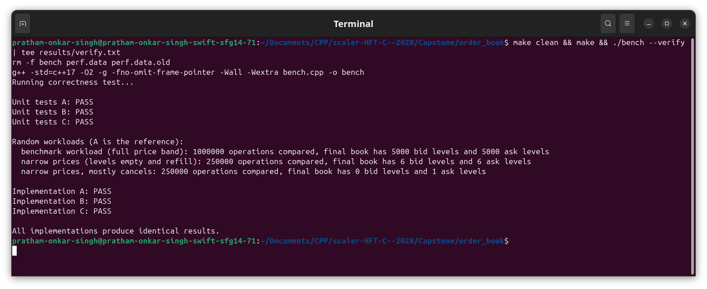
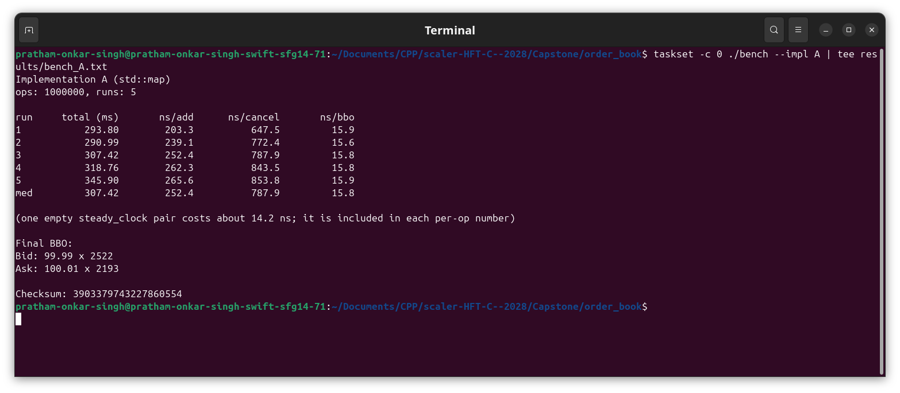
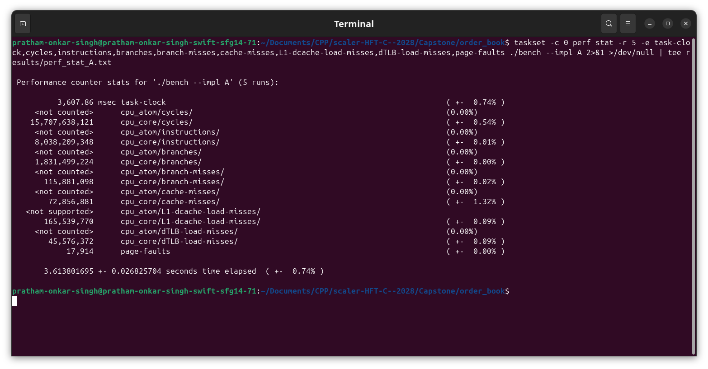
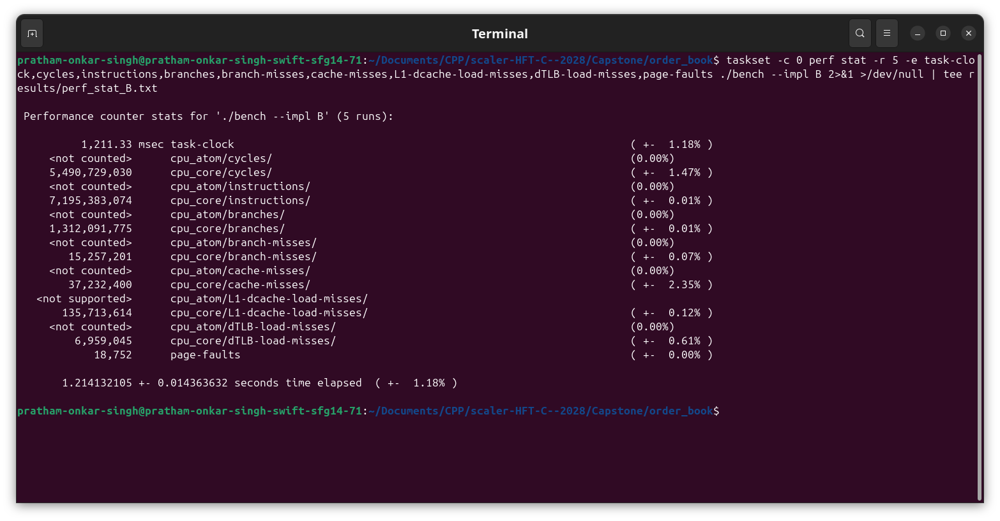
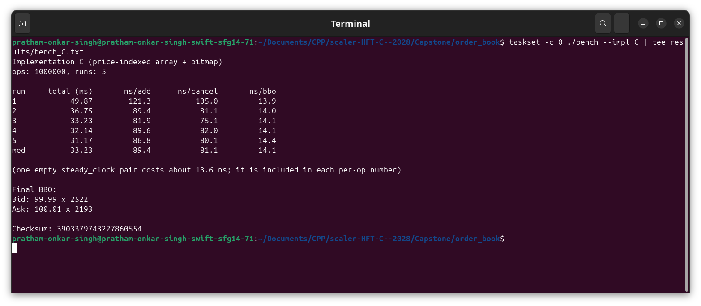
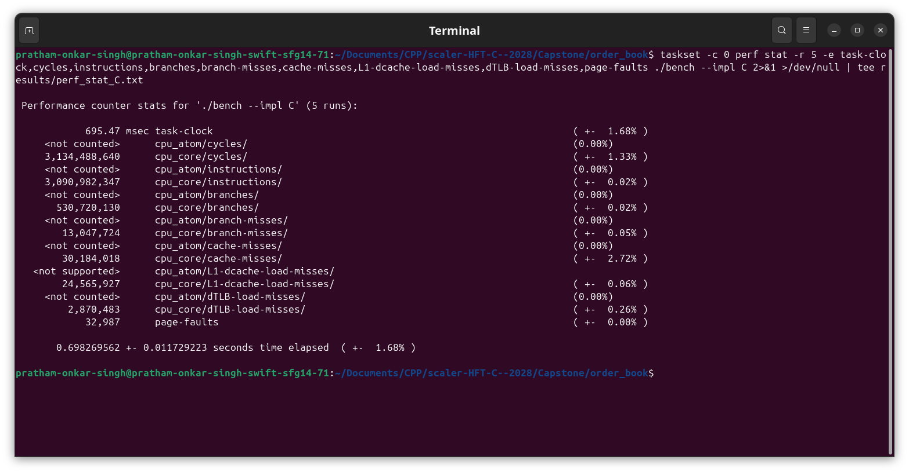

# Capstone: Low-Latency Order Book

name: Pratham Onkar Singh

email: pratham.24bcs10136@sst.scaler.com

roll_no: 24bcs10136

A resting order book for one instrument, built three times with three different data structures, checked against each other, benchmarked on one shared workload and profiled with Linux `perf`. The results table and the performance analysis are in [REPORT.md](REPORT.md).

## Files

```
common.hpp      Price, Side, Level, BBO, Order, band constants, helpers
map_book.hpp    Implementation A: std::map
heap_book.hpp   Implementation B: priority_queue with lazy deletion + hash maps
array_book.hpp  Implementation C: price-indexed arrays + bitmap + flat hash table (my own design)
bench.cpp       workload, --verify and --impl A|B|C
Makefile
REPORT.md       results table and analysis
results/        verify output, benchmark output, perf stat, perf report
screenshots/    terminal screenshots of every step
```

## Build and run

```
make                       # g++ -std=c++17 -O2 -g -fno-omit-frame-pointer -Wall -Wextra bench.cpp -o bench
./bench --verify           # correctness test
./bench --impl A           # or B, or C
```

`-g -fno-omit-frame-pointer` only exist so `perf report` can show names and call stacks; the code is still compiled with `-O2`. Optional flags: `--runs N` (default 5) and `--ops N` (default 1,000,000).

perf commands used (pinned to one P-core with `taskset -c 0` because this laptop has P and E cores, so the `cpu_atom` lines say `<not counted>`):

```
taskset -c 0 perf stat -r 5 -e task-clock,cycles,instructions,branches,branch-misses,cache-misses,L1-dcache-load-misses,dTLB-load-misses,page-faults ./bench --impl A
taskset -c 0 perf record -g ./bench --impl A      # then: perf report
```

`perf_event_paranoid` was 4 on this machine, so I lowered it with `sysctl -w kernel.perf_event_paranoid=-1` to let perf read the counters. All requested counters were available on the P-core. `L1-dcache-load-misses` is `<not supported>` on the E-core (`cpu_atom`) only.

## Interface changes

Prices are integer ticks of 0.01 instead of `double` (100.01 is `10001`, 50.00 is `5000`), as suggested in the brief. `Price` is `int32_t`, and `Level` and `BBO` carry `Price`. Doubles cannot hold 100.01 exactly, and ticks make the price an array index in C.

```cpp
using Price = int32_t;
void add_order(uint64_t id, Side side, Price price, long qty);
```

Everything else matches the given API. `add_order` silently ignores an order whose price is outside its band (bids 5000..9999, asks 10001..15000), whose qty is <= 0, or whose id is already live. `cancel_order` returns `false` for an unknown or already-cancelled id.

## The three designs

| | A: map | B: heap | C: array + bitmap |
|---|---|---|---|
| orders stored in | `std::map<id, Order>` (red-black tree) | `unordered_map<id, Order>` (chained hash) | one flat open-addressing hash table of 24-byte slots, linear probing, backward-shift delete (no tombstones) |
| price levels stored in | `std::map<price, qty>` per side | `unordered_map<price, {qty, in_heap}>` per side, plus a `priority_queue<price>` per side | `long qty[5000]` per side, index = price - band start |
| best bid / ask | `begin()` of the level map | top of the heap after popping dead prices (lazy deletion) | highest / lowest set bit of a 2-level bitmap per side |
| find order on cancel | tree search by id | hash lookup by id | probe the flat table by id |
| top-`d` levels | walk `d` nodes | copy the heap, pop until `d` live prices | walk set bits of the bitmap |

- **A** is the straightforward version: two sorted trees. Cancelling a level's last order erases the node.
- **B** never touches the heap on cancel. A price whose qty hits 0 stays in the heap as a dead entry and is popped only when it reaches the top (`get_bbo`, `get_bids`). `in_heap` makes sure a price is in the heap at most once. A heap can only show its top, so `get_bids/get_asks` copy it.
- **C** is my own design. Qty lives in a plain array, so add and cancel are an index plus an add. The two-level bitmap (79 words of 64 bits, plus 2 summary words) answers "highest/lowest non-empty price" with a couple of `ctz`/`clz` instructions, so BBO never scans and never keeps a cached best that has to be repaired after a cancel. Orders are in a flat hash table instead of a vector indexed by id, so any 64-bit id works.

Complexity (N live orders, L price levels on a side, at most 5000, d = depth asked for, k = dead heap entries popped):

| Operation | A map | B heap | C array + bitmap |
|---|---|---|---|
| `add_order` | O(log N + log L) | O(1) avg, +O(log L) when a price enters the heap | O(1) avg (O(N) on the rare table growth) |
| `cancel_order` | O(log N + log L) | O(1) avg | O(1) avg |
| `get_bbo` | O(1) | O(1) amortized (each dead price popped once, O(log L)) | O(1) (at most 3-4 word reads) |
| `get_bids` / `get_asks` | O(d) | O(L + (d + k) log L) | O(d) |

## Correctness test

`./bench --verify` first runs hand-written cases on each book alone: empty book, cancel of an unknown id, cancel of the same id twice, quantities adding up at one price, asking for 10 levels when fewer exist, best price moving when a level empties, a level refilling, band edges, out-of-band / zero-qty / duplicate-id orders being ignored, and very large ids.

Then the same random workloads go through A, B and C together and are compared after every operation: the result of every cancel, the BBO on every BBO query, and the top 1, 10 and 40 levels on both sides every 100 operations, plus a full dump of every level at the end. A is the reference. Workloads:

1. the benchmark workload (1M ops, seed 42, full price band)
2. 250k ops on only 6 price ticks per side with 45% cancels, plus extra cancels of already-cancelled and never-used ids (these must return `false`)
3. 250k ops on 3 ticks per side with 60% cancels

The wide band alone almost never empties a level, so workloads 2 and 3 are what exercise level removal, best-price movement and re-adding. To check that `--verify` is not blind, I broke C on purpose (clearing a bitmap bit one cancel too early) and it printed `Implementation C: FAIL`.

```
Running correctness test...

Unit tests A: PASS
Unit tests B: PASS
Unit tests C: PASS

Random workloads (A is the reference):
  benchmark workload (full price band): 1000000 operations compared, final book has 5000 bid levels and 5000 ask levels
  narrow prices (levels empty and refill): 250000 operations compared, final book has 6 bid levels and 6 ask levels
  narrow prices, mostly cancels: 250000 operations compared, final book has 0 bid levels and 1 ask levels

Implementation A: PASS
Implementation B: PASS
Implementation C: PASS

All implementations produce identical results.
```



## Benchmark

One program, one workload for every implementation. It is generated before timing with `std::mt19937 rng(42)`: 1,000,000 ops, about 70% add / 20% cancel / 10% BBO, side 50/50, qty 1..100, a random valid tick in the side's band, every cancel picks a currently live order, and every 100 ops it also calls `get_bids(10)` and `get_asks(10)`.

Each run does two passes on a fresh book:

1. no per-operation timing: gives the **total time**
2. every add / cancel / BBO call wrapped in its own `steady_clock` pair: gives **ns per operation**

Each implementation is run 5 times and the median is reported. Both passes feed one checksum of every cancel result, BBO and depth result, printed at the end together with the final BBO (so nothing can be optimised away). All three implementations print the same checksum, `3903379743227860554`. The program also prints the cost of one empty `steady_clock` pair, which is included in every per-op number (about 12-13 ns).

Outputs: A ([bench](screenshots/02-A-bench.png), [perf stat](screenshots/05-A-perf-stat.png), [perf report](screenshots/08-A-perf-report.png)), B ([bench](screenshots/03-B-bench.png), [perf stat](screenshots/06-B-perf-stat.png), [perf report](screenshots/09-B-perf-report.png)), C ([bench](screenshots/04-C-bench.png), [perf stat](screenshots/07-C-perf-stat.png), [perf report](screenshots/10-C-perf-report.png)). Raw text is in `results/`.








## Results

| Metric | A map | B heap | C array + bitmap |
|---|---|---|---|
| Total time (ms) | 307.4 | 79.4 | 33.2 |
| ns / add | 252.4 | 86.2 | 89.4 |
| ns / cancel | 787.9 | 208.3 | 81.1 |
| ns / BBO | 15.8 | 33.2 | 14.1 |
| IPC | 0.51 | 1.31 | 0.99 |
| Branch misses (%) | 6.33% | 1.16% | 2.46% |
| L1-dcache-load-misses | 165.5 M | 135.8 M | 24.6 M |
| Cache misses | 72.9 M | 37.2 M | 30.2 M |
| Page faults | 17,914 | 18,752 | 32,987 |

Time rows: median of the 5 internal runs. Counter rows: `perf stat -r 5`, which averages whole-process executions (workload generation, 5 runs x 2 passes, clock calibration), so they are not per-pass. IPC = instructions / cycles and branch-miss % = branch-misses / branches, both computed from the `cpu_core` counters. More counters (dTLB misses, instructions, branches) are in `results/perf_stat_*.txt` and in [REPORT.md](REPORT.md).
