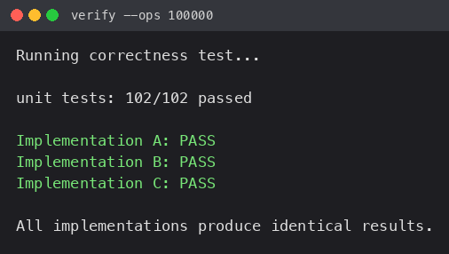
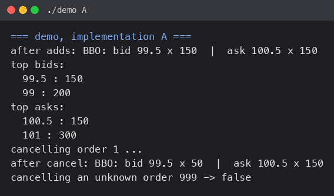
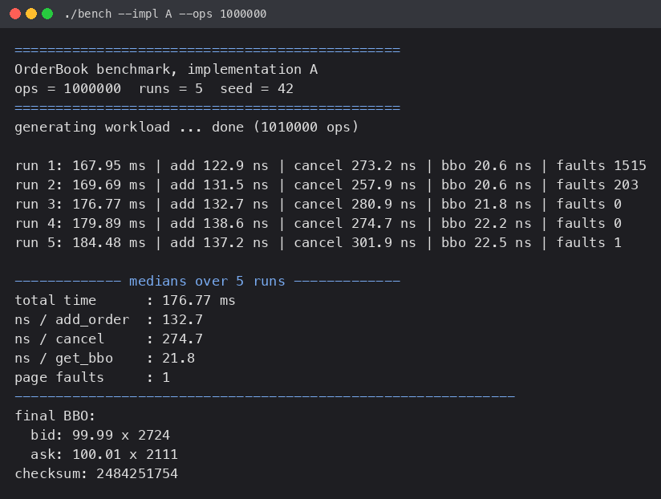
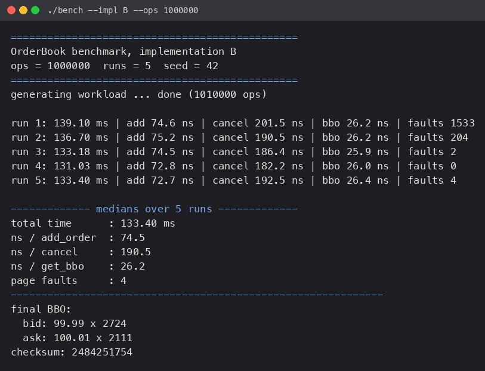
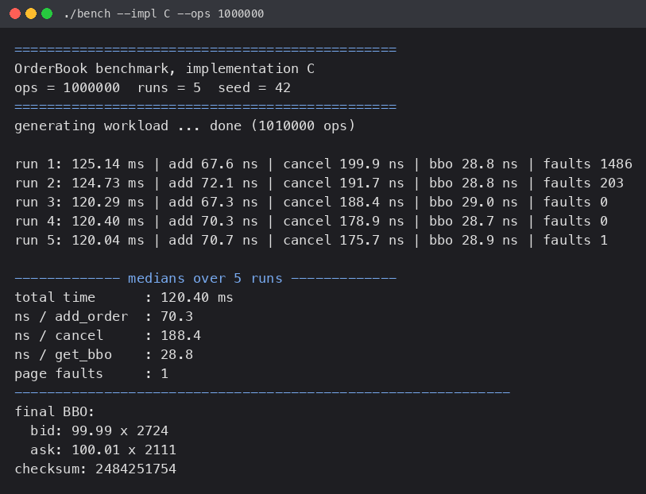
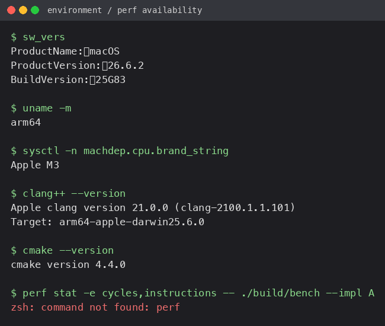

# Low-Latency Order Book (HFT Capstone)

| Name | SST Roll No | SST Email |
| :--- | :--- | :--- |
| Khushi Sarawagi | 24BCS10361 | khushi.24bcs10361@sst.scaler.com |

A single-instrument resting order book, built three different ways, with one
benchmark harness and one correctness checker.

- No matching, no trades. Orders rest until cancelled.
- One instrument, tick size `0.01`, bids in `[50.00, 99.99]`, asks in
  `[100.01, 150.00]`, mid `100.00`, 10000 possible price levels.
- Single threaded, standard library only, compiles with `-O2`.

## 1. Layout

```
OrderBook/
  order.h              enums + structs + the base OrderBook class
  bench.cpp            one benchmark for all three impls, also does --verify
  verify.cpp           separate correctness checker (unit tests + random run)
  demo.cpp             small demo, pick impl on the command line
  CMakeLists.txt
  impl_a/              A: std::map + unordered_map
  impl_b/              B: two priority queues + lazy deletion
  impl_c/              C: fixed array indexed by price tick (my own design)
  screenshots/         terminal output from the runs on my machine
  IMPLEMENTATIONS.md   per-impl data structures + Big-O
  REPORT.md            perf + the section 11 performance analysis
```

## 2. Build

With CMake:

```bash
cmake -S . -B build -DCMAKE_BUILD_TYPE=Release
cmake --build build -j4
```

Or if you don't want CMake, a single g++ line does the same thing:

```bash
g++ -O2 -std=c++17 bench.cpp impl_a/orderbook_a.cpp impl_b/orderbook_b.cpp impl_c/orderbook_c.cpp -o bench
```

`build/` should end up with `bench`, `verify` and `demo`.

## 3. Correctness first

Run this before looking at any timings:

```bash
./build/verify --ops 100000
```

It runs some hand-written unit tests (empty book, qty adds up at a price,
better price wins, depth truncation, cancel twice, cancel unknown returns
false, etc.) on all three books, then pushes the same random workload through
all three and compares the BBO and the top-10 depth after every step. Any
mismatch prints the op number and fails.

The benchmark file also has a `--verify` flag that does the same random
cross-check:

```bash
./build/bench --verify --ops 100000 --seed 42
```

Both print `PASS` for A, B and C and exit 0.



## 4. Benchmarks

One binary, implementation picked with `--impl`:

```bash
./build/bench --impl A --ops 1000000 --runs 5 --seed 42
./build/bench --impl B --ops 1000000 --runs 5 --seed 42
./build/bench --impl C --ops 1000000 --runs 5 --seed 42
```

Flags: `--impl A|B|C`, `--ops N`, `--runs N`, `--seed S`, `--verify`.

The workload is 70% add / 20% cancel / 10% BBO, plus a `get_bids(10)` +
`get_asks(10)` every 100 ops, with `std::mt19937(seed)` so the exact same
sequence is replayed for every implementation. Cancels only ever pick an id
that is still live. Per-op times are measured with `steady_clock` and the
median of the runs is printed. The final BBO and a checksum go to stdout so
nothing gets optimised away.

### Demo run



## 5. Interface notes

- The public API is the one from the assignment. `BBO` has the flat
  `has_bid / bid_price / bid_qty / has_ask / ask_price / ask_qty` fields.
- `OrderBook` in `order.h` was turned into an abstract base class so the
  benchmark can hold one pointer type and call any of the three. A, B and C
  derive from it. The five methods and their signatures are unchanged.
- Prices come in as `double` but are immediately converted to integer ticks
  (`price * 100`, e.g. `99.50 -> 9950`) inside the book, so all the internal
  comparisons are on integers. This is why `order.h` has `to_ticks` /
  `to_price`.
- Cancelling a missing / already-cancelled order returns `false` and changes
  nothing. Empty book gives `has_bid == has_ask == false`. Asking for depth 10
  when there are 3 levels returns 3.

## 6. The three designs

| | order storage | price levels | best price | cancel |
| :--- | :--- | :--- | :--- | :--- |
| **A** `std::map` | `unordered_map<id, Info>` | two `std::map<tick, qty>` (desc / asc) | `begin()` | hash lookup + `map` erase |
| **B** `priority_queue` | `unordered_map<id, (level, qty)>` | two heaps of level pointers | heap `top()` + prune stale | lazy: just subtract qty |
| **C** array (mine) | `unordered_map<id, Info>` | two `vector<long>` of size 5000 | scan inwards from the edge | hash lookup + array bump |

Full write-up and Big-O tables are in [IMPLEMENTATIONS.md](IMPLEMENTATIONS.md).

## 7. Results

Machine: Apple M3 (arm64), macOS 26.6.2, Apple clang 21, `-O2`.
1,000,000 ops, 5 runs, seed 42, median reported.

| Metric | A (`std::map`) | B (`priority_queue`) | C (array) |
| :--- | :---: | :---: | :---: |
| Total time (ms) | 176.77 | **133.40** | **120.40** |
| ns / add_order | 132.7 | 74.5 | **70.3** |
| ns / cancel | 274.7 | 190.5 | **188.4** |
| ns / get_bbo | **21.8** | 26.2 | 28.8 |
| Page faults (median) | 1 | 4 | 1 |
| Final BBO | `99.99 x 2724 / 100.01 x 2111` | same | same |
| Checksum | `2484251754` | same | same |

All three end on the same book and the same checksum, which is the main
sanity check. C is fastest on add/cancel, A is fastest on BBO, B sits in the
middle. The reasoning is in [REPORT.md](REPORT.md).





## 8. About `perf`

`perf` is a Linux tool and this machine is a Mac, so the `perf stat` /
`perf record` sections could not be run here:



Because of that the hardware counters (cycles, instructions, IPC, branch
misses, cache misses, ...) are not available in this report. I put what the
program can measure itself (`getrusage` page faults, the timings) in the
results, and the section 11 analysis in [REPORT.md](REPORT.md) is based on
reading the implementations and on those measurements rather than on
counters. To fill in the `perf stat` table the benchmark just needs to be run
on a Linux box:

```bash
perf stat -r 5 -e task-clock,cycles,instructions,branches,branch-misses,cache-misses,L1-dcache-load-misses,dTLB-load-misses,page-faults -- ./bench --impl A --ops 1000000 --runs 1 --seed 42
```
