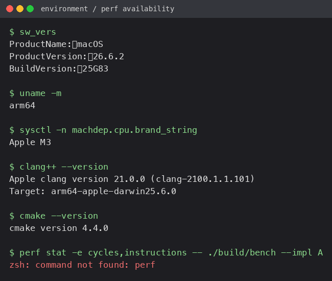

# Benchmark report & performance analysis

| Name | Roll No | Email |
| :--- | :--- | :--- |
| Khushi Sarawagi | 24BCS10361 | khushi.24bcs10361@sst.scaler.com |

## 1. Setup

- **Machine**: Apple M3 (arm64), macOS 26.6.2, 8 cores.
- **Compiler**: Apple clang 21.0.0, `-O2 -Wall -Wextra`, C++17.
- **Workload**: 1,000,000 operations, seed 42 (`std::mt19937`), 70% add /
  20% cancel / 10% BBO plus a depth query every 100 ops.
- **Runs**: 5 per implementation, median reported, per-op timing with
  `steady_clock`.

```bash
./build/bench --impl A --ops 1000000 --runs 5 --seed 42
./build/bench --impl B --ops 1000000 --runs 5 --seed 42
./build/bench --impl C --ops 1000000 --runs 5 --seed 42
```

## 2. Correctness

Before timing anything, all three books are pushed through the same stream and
their BBO + top-10 depth are compared after every op:

```bash
./build/verify --ops 100000
./build/bench --verify --ops 100000 --seed 42
```

Both: 102/102 unit checks pass, A/B/C all PASS, exit code 0.

The strongest check is that all three runs finish on the same book and print
the same checksum (`2484251754`), which they do.

## 3. Results

Median of 5 runs, 1,000,000 ops, seed 42.

| Metric | A (`std::map`) | B (`priority_queue`) | C (array) |
| :--- | :---: | :---: | :---: |
| Total time (ms) | 176.77 | 133.40 | 120.40 |
| ns / add | 132.7 | 74.5 | 70.3 |
| ns / cancel | 274.7 | 190.5 | 188.4 |
| ns / BBO | 21.8 | 26.2 | 28.8 |
| Page faults (median) | 1 | 4 | 1 |
| Final BBO | `99.99 x 2724 / 100.01 x 2111` | same | same |
| Checksum | 2484251754 | same | same |

Raw per-run lines (as printed by the program, also in `screenshots/`):

```
A: 167.95 169.69 176.77 179.89 184.48 ms   (median 176.77)
B: 139.10 136.70 133.18 131.03 133.40 ms   (median 133.40)
C: 125.14 124.73 120.29 120.40 120.04 ms   (median 120.40)
```

Note the machine was not idle (load average ~3 from other apps), so the
absolute numbers move a bit between sessions. The *ranking* was the same in
every session I ran: C and B clearly ahead of A on add/cancel, A ahead on BBO.

## 4. `perf` — not available here

`perf` is Linux-only and this was run on macOS, so `perf stat` and
`perf record` could not be executed:



So the hardware counters (cycles, instructions, IPC, branch-misses,
cache-misses, L1-dcache-load-misses, dTLB-load-misses) are **unavailable** in
this report; there is no `perf stat`/`perf report` output to show because I
won't print numbers I didn't measure. What I *could* measure from inside the
program is page faults (via `getrusage`) and that is in the table above.

The exact command to complete the counter table on a Linux machine is:

```bash
perf stat -r 5 -e task-clock,cycles,instructions,branches,branch-misses,cache-misses,L1-dcache-load-misses,dTLB-load-misses,page-faults -- ./bench --impl <A|B|C> --ops 1000000 --runs 1 --seed 42
```

The section 11 answers below are therefore based on the timings, on the page
fault counts, and on reading the data structures, not on counters. Where I am
predicting a counter I say so.

---

## 5. Section 11 analysis

### 11.1 Which implementation is fastest?

**`add_order`**: **C (70.3 ns)**, with B essentially tied (74.5 ns); A is
nearly 2x slower (132.7 ns). C inserts with one array index and one add. B also
does a hash lookup and a qty bump, and only pushes to a heap when the price
level is new, so it is usually a couple of hash operations. A does a hash
insert *and* a red-black tree walk (and a node allocation) on every single add,
which is the `log P` cost showing up.

**`cancel_order`**: **C (188.4 ns)** and **B (190.5 ns)** about the same, A
worst (274.7 ns). B's cancel is lazy — it subtracts the qty through a stored
pointer and does nothing else. C subtracts from an array slot. A has to look up
the level in the tree, and if the level hits zero, erase it and let the tree
rebalance.

**`get_bbo`**: **A (21.8 ns)**, then B (26.2 ns), then C (28.8 ns). A keeps its
levels in an always-sorted map, so the best price is literally
`map.begin()` — one pointer read, nothing else. B reads the heap top but also
runs a small loop to drop stale (qty 0) levels. C scans the array from the top
of the band, and although it usually finds a filled slot immediately, the loop
plus its branch is a little more work than A's single dereference. (These three
numbers are close and noisy, but A was ahead in every run, which matches the
code.)

### 11.2 Branch prediction

I can't show branch-miss counters without `perf`, but from the code:

- **A (std::map)** should have the most branch misses. Every tree step compares
  the incoming tick to the current node and branches left or right. Prices are
  uniform random over the band, so the direction is close to a coin flip; the
  predictor has no pattern to learn and will mispredict on the tree walk.
- **C (array)** should have the fewest. Its scan loop keeps taking the "slot is
  empty, go on" branch and then falls out once; that is easily predicted.
- **B (heap)** sits in between: the hash lookups have a data-dependent path and
  `drop_zeros()` has a `while top is stale` loop, but most adds hit an existing
  level (predictable), and cancel does no branching on the heap at all.

This is the classic reason a tree can lose to a "dumber" structure even when
the Big-O looks similar.

### 11.3 Cache behaviour

By the code, the ordering of cache misses should be **A > B > C**:

- **C** is two contiguous `std::vector<long>` of 5000 entries each (~40 KB
  each, ~80 KB total). That fits in L2 and the access pattern is a straight
  index, so it is the friendliest.
- **A** chases pointers: each `std::map` node is a separate heap allocation,
  so walking the tree jumps around memory with poor spatial locality.
- **B** keeps the heap in a contiguous vector, but each element is a pointer to
  a separately allocated `PLevel`, and the id index is a node-based
  `unordered_map`, so it jumps a bit more than C but less than A's pure tree
  walk.

Page faults were very low for all three (median 1–4) because the first run pays
for growing the containers and later runs reuse the memory; the steady-state
working set is small enough that there is almost no new faulting. B's median
was the largest (4) — it allocates a `PLevel` per active price level on top of
the id map and the heaps.

### 11.4 Page faults

A = 1, B = 4, C = 1 (medians). All tiny. The first run of every implementation
shows ~1500 faults and the rest show 0, so the faults are just the one-time
growth of the hash map / heap / vectors as the book fills to ~500k orders.
C did not need a fresh fault after the first run at all because its level
storage is two fixed vectors allocated up front; A and B fault while their
node-based containers grow. This tells me the allocation behaviour differs
(fixed arrays vs. many small growing nodes) even though the end result is the
same book.

### 11.5 Production choice

I would deploy **C**, but only after adding a small top-of-book cache. My
reasoning:

- **Latency**: C has the lowest and most uniform cost on the hot path
  (add/cancel are O(1), no allocation, no tree walk). In a real book almost all
  traffic is adds and cancels.
- **Predictability**: the one weak spot is the `get_bbo` scan. If a side of the
  book is empty that scan is 10000 steps, which is a latency spike on the quote
  path. But this is easy to remove — keep a `best_bid_idx` / `best_ask_idx` and
  only move it when the current top level is emptied. Then every op is O(1)
  with no scan, which is better than A or B can do.
- **Cache / memory**: contiguous arrays, no per-order allocation beyond the id
  map, and a fixed ~80 KB for levels. Much friendlier than A's node-per-level
  tree.
- **Complexity / maintainability**: arguably the simplest of the three to
  reason about — the price band is small and known, so an array is the honest
  structure.

Why not B: it wins on average throughput, but lazy deletion pushes work onto
the next query. When a level empties and later a `get_bbo`/depth query hits a
pile of stale entries, that query pays for all of them at once — a tail-latency
risk that a quote path cannot afford. Not just about the average.

Why not A: it is the most predictable for `get_bbo`, and if I couldn't
maintain the top-of-book pointer I would fall back to A for exactly that
reason — but its per-op cost on add/cancel is the highest of the three, and it
loses on cache behaviour too.

### 11.6 What I'd try next

- **Bitmap for the best price.** Two `uint64_t[79]` bitmaps (one per side)
  marking which ticks have qty, then `__builtin_clzll`/`ctzll` to find the best
  tick in one instruction. Removes C's scan entirely and is branch-free.
- **Cached top-of-book.** Keep `best_bid_idx`/`best_ask_idx` and advance them
  lazily as above.
- **Object pool / arena for order storage.** Replace the node-based
  `unordered_map` with an open-addressed table or a slab allocator, so cancel
  does one probe and never touches `malloc`.
- **Store `Level` as a packed struct** (`int32` price, `int64` qty) in the
  array instead of two parallel vectors, to keep a level's price and qty on the
  same cache line.
- **Reduce timer overhead.** The per-op `steady_clock` calls add a fixed cost
  to every measurement; batching timing around whole operation classes would
  give cleaner per-op figures.
